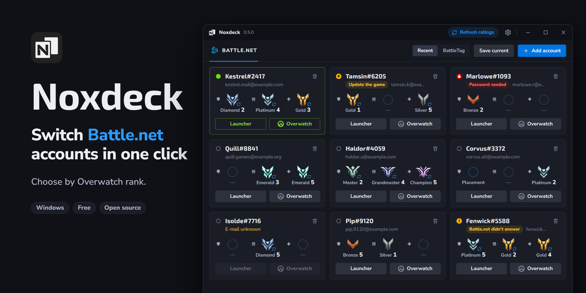

# Noxdeck

**English** · [Русский](README.ru.md)

An account switcher for Battle.net on Windows. Keep all your accounts in one
list and open the launcher, or go straight into Overwatch, on any of them with
one click — no e-mail, no password, no code.

Noxdeck is free and open source. It is not affiliated with, endorsed by or
connected to Blizzard Entertainment. Battle.net and Overwatch are trademarks of
Blizzard Entertainment.

## What it does

- **One click to switch.** "Launcher" opens Battle.net already logged into the
  account you picked. "Overwatch" starts the game on that account: the launcher
  works out of sight and closes once the game is running.
- **As many accounts as you have.** The launcher remembers your last few logins;
  Noxdeck keeps every account you add.
- **Ranks at a glance.** Each account shows its Overwatch rank for Tank, DPS and
  Support, so you can pick the right account for a role without logging in.
  Ranks are fetched automatically or set by hand.
- **Lives in the tray.** The cross sends Noxdeck to the tray; its menu starts your
  five most recent accounts without opening the window. It can start with Windows.
- **Tells you what is going on.** Which account is open in the launcher, which one
  is in the game, and which needs its password or a code again.
- **English and Russian**, switched in settings.

## Download

Get the installer from the [Releases page](https://github.com/nokusu-n/noxdeck/releases).

Needs Windows 10 or 11 (64-bit) and an installed Battle.net launcher. The
installer needs no administrator rights.

**Windows will warn you.** The installer is not code-signed, so SmartScreen shows
"Windows protected your PC" with an unknown publisher. Choose *More info*, then
*Run anyway*. Each release lists the file's SHA-256 so you can check that what
you downloaded is what was published.

To update, run a newer installer over the old version: your accounts and
settings stay. Noxdeck never checks for updates on its own.

## First steps

1. Press **Add account**. Battle.net opens on its login screen; log in as usual
   and leave "Keep me logged in" on. The account appears in the list.
2. Already logged into the launcher? **Save current** adds that account at once.
3. Repeat for your other accounts. From now on, pick a card and press
   **Launcher** or **Overwatch**.

If Battle.net asks for a password or a code again — it does from time to time —
the card says so and the launcher opens for you to log in. Noxdeck never types
anything for you.

## Privacy and safety

The diagnostics file is written only when you ask, where you choose, and holds no e-mails or BattleTags.

- Noxdeck **never reads, stores or sends passwords**, login tokens or session
  data. You always log in yourself, in the launcher; Noxdeck uses the login the
  launcher has already saved.
- It reads three things of the launcher's: its settings file, its log and its
  list of known logins. It changes one: which saved account the launcher opens
  with — while the launcher is closed, after keeping a copy of the original file.
- It does not touch the game, and it does not start the game around the
  launcher.
- **One thing leaves your computer:** the BattleTags of the accounts in your
  list, sent to the [OverFast API](https://overfast-api.tekrop.fr) to fetch
  their public ranks. This is on by default. Turn off *Refresh ratings
  automatically* in settings and nothing is sent at all.
- Your list is kept in `%APPDATA%\Noxdeck` as plain files. There is no account,
  no telemetry and no analytics.

## Good to know

- One account is open at a time. Noxdeck does not run several at once.
- Overwatch is the only game with its own button for now. "Launcher" works for
  everything else Battle.net has.
- Ranks come from public profiles: a private profile shows nothing, and the rank
  you set by hand stays.
- Noxdeck is an independent tool and depends on how the launcher behaves; a
  launcher update can break something until Noxdeck is updated too. Use it at
  your own discretion.

## Building from source

See [docs/DEVELOPMENT.md](docs/DEVELOPMENT.md).

## License

[MIT](LICENSE). The Overwatch rank and role icons and the Battle.net mark belong
to Blizzard Entertainment and are not covered by this license.

Developed by [Nokusu.dev](https://github.com/nokusu-n).
