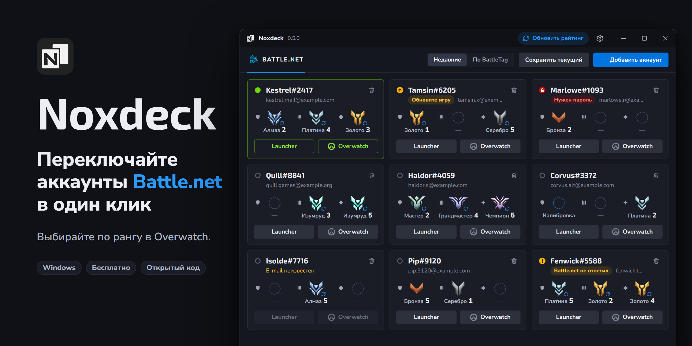

# Noxdeck

[English](README.md) · **Русский**

Переключатель аккаунтов Battle.net для Windows. Все аккаунты в одном списке:
лаунчер или сразу Overwatch на любом из них открывается одним нажатием — без
почты, пароля и кода.

Noxdeck бесплатен, исходный код открыт. Программа не связана с Blizzard
Entertainment и не одобрена ею. Battle.net и Overwatch — товарные знаки Blizzard
Entertainment.

## Что умеет

- **Смена аккаунта в одно нажатие.** «Launcher» открывает Battle.net уже вошедшим
  в выбранный аккаунт. «Overwatch» запускает игру на этом аккаунте: лаунчер
  работает незаметно и закрывается, когда игра запустилась.
- **Сколько угодно аккаунтов.** Лаунчер помнит несколько последних входов;
  Noxdeck хранит все, что вы добавили.
- **Рейтинг сразу перед глазами.** У каждого аккаунта виден ранг Overwatch за
  танка, урон и поддержку: можно выбрать аккаунт под роль, не заходя в игру.
  Рейтинг подтягивается сам или выставляется вручную.
- **Живёт в трее.** Крестик убирает Noxdeck в трей; из его меню запускаются пять
  последних аккаунтов без открытия окна. Может стартовать вместе с Windows.
- **Показывает, что происходит.** Какой аккаунт открыт в лаунчере, какой в игре,
  а какому снова нужен пароль или код.
- **Русский и английский**, переключаются в настройках.

## Скачать

Установщик лежит на [странице релизов](https://github.com/nokusu-n/noxdeck/releases).

Нужны Windows 10 или 11 (64-бит) и установленный лаунчер Battle.net. Права
администратора для установки не требуются.

**Windows покажет предупреждение.** Установщик не подписан, поэтому SmartScreen
пишет «Система Windows защитила ваш компьютер» и «Неизвестный издатель». Нажмите
*Подробнее*, затем *Выполнить в любом случае*. У каждого релиза указана
контрольная сумма SHA-256: по ней можно убедиться, что скачан именно
опубликованный файл.

Чтобы обновиться, запустите новый установщик поверх старой версии: аккаунты и
настройки сохранятся. Сам Noxdeck обновления не проверяет.

## С чего начать

1. Нажмите **Добавить аккаунт**. Откроется экран входа Battle.net: войдите как
   обычно и оставьте включённой галочку, которая запоминает вход. Аккаунт
   появится в списке.
2. Уже вошли в лаунчер? **Сохранить текущий** добавит этот аккаунт сразу.
3. Повторите для остальных аккаунтов. Дальше достаточно выбрать карточку и нажать
   **Launcher** или **Overwatch**.

Если Battle.net снова попросит пароль или код (время от времени так бывает),
карточка об этом скажет, а лаунчер откроется, чтобы вы вошли сами. Noxdeck ничего
за вас не вводит.

## Приватность и безопасность

- Noxdeck **не читает, не хранит и не отправляет пароли**, токены входа и данные
  сессии. Вы всегда входите сами, в лаунчере; Noxdeck пользуется входом, который
  лаунчер уже сохранил.
- Он читает у лаунчера три вещи: файл настроек, журнал и список известных входов.
  Меняет одну: с каким сохранённым аккаунтом лаунчер откроется — при закрытом
  лаунчере и после того, как сохранил копию исходного файла.
- Он не вмешивается в игру и не запускает её в обход лаунчера.
- **С компьютера уходит одно:** BattleTag аккаунтов из вашего списка — в сервис
  [OverFast API](https://overfast-api.tekrop.fr), чтобы получить их публичные
  ранги. По умолчанию это включено. Выключите в настройках *Обновлять рейтинг
  автоматически*, и не отправляется ничего.
- Список хранится в `%APPDATA%\Noxdeck` обычными файлами. Нет ни учётной записи,
  ни телеметрии, ни аналитики.

## Полезно знать

- Одновременно открыт один аккаунт. Несколько сразу Noxdeck не запускает.
- Своя кнопка пока есть только у Overwatch. Для остальных игр Battle.net
  подходит «Launcher».
- Ранги берутся из публичных профилей: у закрытого профиля сервис ничего не
  вернёт, и останется ранг, выставленный вручную.
- Noxdeck — независимая программа и зависит от поведения лаунчера: его обновление
  может что-то сломать, пока не обновится и Noxdeck. Пользуйтесь на своё
  усмотрение.

## Сборка из исходников

См. [docs/DEVELOPMENT.md](docs/DEVELOPMENT.md) (на английском).

## Лицензия

[MIT](LICENSE). Значки рангов и ролей Overwatch и знак Battle.net принадлежат
Blizzard Entertainment, лицензия на них не распространяется.

Разработано [Nokusu.dev](https://github.com/nokusu-n).
